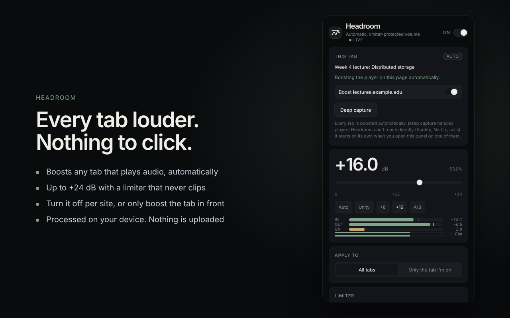

# Headroom

Automatic, limiter-protected volume boost. Audio stays on your device.

## Windows app: boost everything on your PC

**[Download Headroom-Setup.exe](https://github.com/muamerarifi-pixel/headroom.volumebooster/releases/latest/download/Headroom-Setup.exe)** (Windows 10/11, 64-bit)

The Windows app boosts **every** sound the PC plays (browsers, Spotify, games, video players, calls) by up to +24 dB, all the time, with a limiter that stops clipping. See [windows/README.md](windows/README.md) for setup and how it works.

## Chrome extension: boost browser tabs

- **Automatic:** any tab that plays audio or video is boosted the moment it starts. Nothing to click.
- **Up to +24 dB with studio-grade limiting:** calibrated `-0.8 dBFS` brickwall ceiling, true-bypassable compressor in Transparent mode, 25 Hz infrasonic rumble filter, and a distortion-free 4x-oversampled safety ceiling.
- **Auto-Level (gated AGC):** smoothly rides gain over a ~1.5 s loudness window to keep quiet and loud videos consistent, with a silence gate so pauses don't boost hiss.
- **Voice Clarity & Mono:** one-click 90 Hz rumble cut + vocal presence lift for lectures/podcasts/calls, plus click-free Mono fold-down for one-channel videos or single-earbud listening.
- **Per-site pinning & Sites manager:** turn boost off for any site, pin a custom profile per host (normalized across `www.`), and manage all pinned/muted sites from the popup.
- **Three limiter styles:** Transparent, Balanced and Night.
- **"Active tab" mode:** boost only the tab you're looking at (works in both Auto and Deep capture).
- **Deep capture** for players the page boost can't reach (Spotify, Netflix, web calls): open the popup on that tab, or press `Alt+Shift+B`.

## Install

1. **[Download headroom.zip](https://github.com/muamerarifi-pixel/headroom.volumebooster/releases/latest/download/headroom.zip)** and unzip it. You get a folder named `headroom`.
2. Move that folder somewhere permanent (for example `Documents/Extensions/headroom`). Chrome loads the extension from this folder, so don't delete it.
3. Open `chrome://extensions` (or `brave://extensions`) and turn on **Developer mode** (top right).
4. Click **Load unpacked** and select the `headroom` folder (the one that contains `manifest.json`).

Works in Chrome, Edge, Brave and Opera (version 116 or newer).

## Update

Download [headroom.zip](https://github.com/muamerarifi-pixel/headroom.volumebooster/releases/latest/download/headroom.zip) again, replace the files in your folder, then click the reload ↻ icon on Headroom's card in `chrome://extensions`.

## Shortcuts

| Shortcut | Action |
|---|---|
| `Alt+Shift+H` | Turn Headroom on or off |
| `Alt+Shift+B` | Deep-capture the current tab (press again to stop) |

Change them at `chrome://extensions/shortcuts`. You can also scroll the mouse wheel over the boost panel in the popup to nudge gain in `0.5 dB` steps.

## Privacy

All audio is processed locally in your browser. Headroom has no servers, no analytics and no accounts. Nothing is recorded or uploaded. See [PRIVACY.md](PRIVACY.md) for the full policy.
